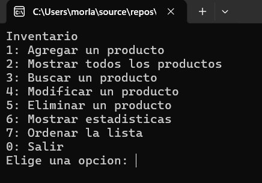
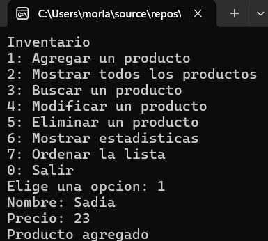
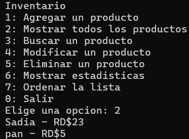
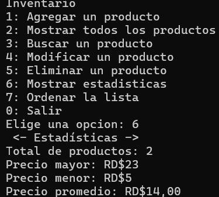
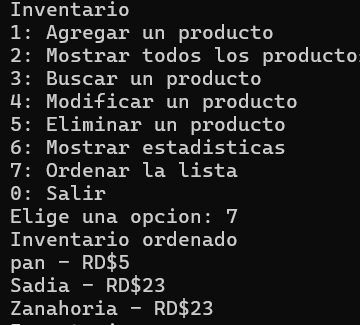

# 🛒 Reyeshop - Inventario de productos

**Desarrollado por:** Yordanis Josue Morla Feliz

**Módulo:** Desarrollo de Aplicaciones y Sistemas de Información

**Tema:** Gestión de listas (`List<T>`)

---

## 📌 Sobre el proyecto

Reyeshop es un pequeño programa de consola desarrollado en C# para gestionar el inventario de una tienda de barrio.

La idea es bastante sencilla: poder registrar productos, guardar sus precios y tener un control de lo que tenemos en el inventario.

El programa cuenta con un menú que permite realizar distintas operaciones. Básicamente, se busca facilitar la administración de los productos sin complicarse demasiado.

## ⚙️ Funciones del programa

1. **Agregar productos:** registra un producto junto con su precio.
2. **Mostrar productos:** muestra los productos y sus respectivos precios.
3. **Buscar productos:** permite encontrar un producto registrado.
4. **Modificar productos:** permite cambiar el nombre y el precio.
5. **Eliminar productos:** elimina un producto junto con su precio.
6. **Mostrar estadísticas:** calcula el total de productos, precio mayor, menor y promedio.
7. **Ordenar lista:** organiza los productos alfabéticamente sin separar sus precios.
8. **Salir:** permite cerrar el programa.

## 💻 Tecnologías utilizadas

- C#
- .NET 10
- Visual Studio
- Git y GitHub

## ▶️ Cómo ejecutar el programa

1. Clona o descarga este repositorio.
2. Abre una terminal dentro de la carpeta del proyecto.
3. Ejecuta el siguiente comando:

```bash
dotnet run
```

Y listo, aparecerá el menú del inventario en la consola.

## 📸 Capturas del programa

A continuación se muestran algunas capturas de la ejecución y las diferentes operaciones realizadas.

### Ejecución del programa



### Agregar un producto



### Mostrar todos los productos



### Mostrar estadísticas



### Ordenar la lista



## 📚 Objetivo de la actividad

Esta práctica tiene como finalidad aplicar los conocimientos adquiridos sobre las listas en C#, utilizar estructuras de control y organizar el código mediante métodos.

En fin, este proyecto representa lo aprendido durante el módulo y la aplicación práctica de esos conocimientos.

---

**Autor:** Yordanis Josue Morla Feliz

**Proyecto académico: Reyeshop**
